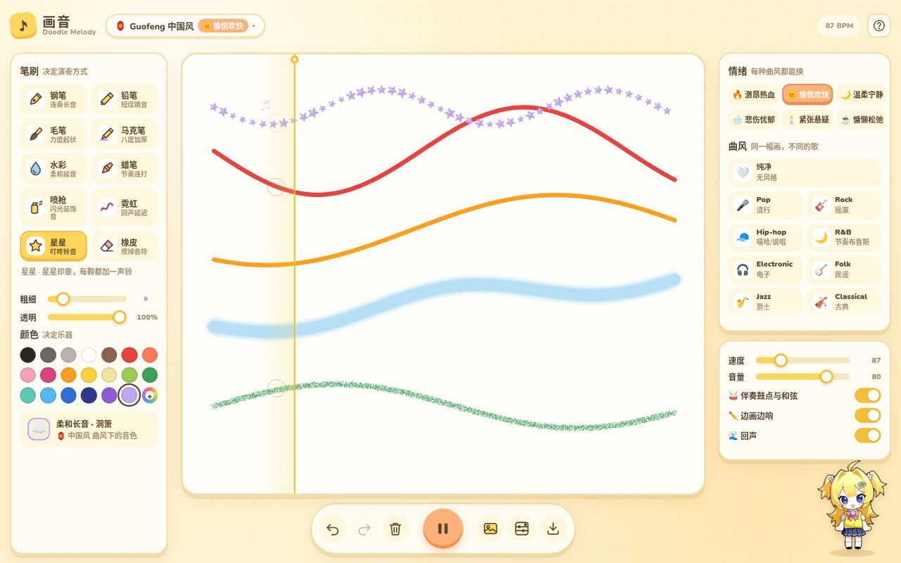
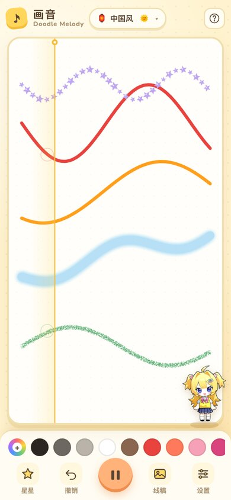

# 画音 Doodle Melody

**一张会唱歌的画布。** 你画下的每一笔，都会变成一段跟着线条起伏的旋律；换一个曲风、换一种情绪，同一幅画就是另一首歌。

纯前端实现，所有声音由浏览器的 Web Audio 实时合成，不需要任何音频文件。





**在线试玩：** <https://neta.art/w/rain/doodle-melody/doodle-melody>

---

## 目录

- [三步就上手](#三步就上手)
- [玩法规则](#玩法规则)
  - [1. 画布是一张乐谱](#1-画布是一张乐谱)
  - [2. 一条线＝一个声音](#2-一条线一个声音)
  - [3. 颜色决定乐器](#3-颜色决定乐器)
  - [4. 笔刷决定演奏方式](#4-笔刷决定演奏方式)
  - [5. 曲风：换个伴奏](#5-曲风换个伴奏)
  - [6. 情绪：换个心情](#6-情绪换个心情)
  - [7. 纯净模式：没有伴奏](#7-纯净模式没有伴奏)
- [进阶玩法：用图片线稿演奏](#进阶玩法用图片线稿演奏)
- [编辑、撤销与保存](#编辑撤销与保存)
- [画得好听的小技巧](#画得好听的小技巧)
- [界面说明](#界面说明)
- [桌面宠物霜糖](#桌面宠物霜糖)
- [快捷键](#快捷键)
- [技术实现](#技术实现)
- [本地运行](#本地运行)
- [部署到 GitHub Pages](#部署到-github-pages)
- [项目结构](#项目结构)
- [浏览器支持](#浏览器支持)
- [另一个版本：小红书小工具](#另一个版本小红书小工具)
- [致谢与许可](#致谢与许可)

---

## 三步就上手

1. **画一笔** —— 在画布上随手画一条线。松手的瞬间它已经在响（「边画边响」默认打开）。
2. **按下播放 ▶** —— 一条黄色的播放线从左扫到右，碰到你画的线条就把它唱出来。
3. **换个曲风 / 情绪** —— 同一幅画，立刻变成爵士、中国风或者虚拟歌姬。

第一次打开时，画布右下角的小桌宠 **霜糖** 会带你走一遍 9 步引导，并高亮对应的按钮。之后点她可以随时听小技巧，按住可以把她拖到别处。

---

## 玩法规则

### 1. 画布是一张乐谱

画布是一段 4 小节的循环（64 个十六分音符）：

| 方向 | 含义 |
| --- | --- |
| **从左到右** | 时间。最左边是第一拍，最右边接回开头，循环播放 |
| **从下到上** | 音高。越往上音越高，共 16 级，取自然音阶里的 5 个音（do re mi sol la），跨三个八度 |

因为只用五声音阶，**随便怎么画都不会刺耳** —— 任何几条线叠在一起都是和谐的。

打开右下角设置里的「节点」，可以看到每个音符落在哪一格、音高带在哪里（每 5 级加亮一条）。

### 2. 一条线＝一个声音

这是最好玩的地方：**一笔就是一个连贯的声音，它会跟着你的笔走。**

| 你画的 | 听到的 |
| --- | --- |
| 一条横线 | 一个持续的长音 |
| 一条波浪线 | 旋律跟着上下起伏，像人在唱歌 |
| 一条斜线 | 上行或下行的音阶，像滑梯 |
| 一条竖直的线 | 同一时刻叠了 2～3 个音 —— 一个和弦 |
| 两组交叉的线 | 两条旋律对位，各唱各的 |

线条断开（抬起笔）就是换一句；同一条线里跨过一格，声音会平滑地滑过去，而不是重新敲一下。

### 3. 颜色决定乐器

颜色按色相分成 5 个角色，暖色唱主旋律、深色当低音、白色闪闪发光：

| 颜色 | 角色 | 作用 |
| --- | --- | --- |
| 🔴🟠🟡 红 / 橙 / 黄 / 粉 | 主旋律 🎤 | 最靠前的声部，适合画主干线条 |
| 🟢🩵 绿 / 青 / 浅蓝 | 拨弦与键盘 🎹 | 颗粒清晰，负责节奏感和点缀 |
| 🔵🟣 天蓝 / 海蓝 / 紫 / 薰衣草 | 柔和长音 ☁️ | 铺在背景里的和声，适合画大片长线 |
| ⚫🟤 黑 / 深灰 / 可可 / 藏青 | 低音 🔊 | 降八度，画在画面下方最有力量 |
| ⬜ 白 / 浅灰 | 闪亮铃音 🔔 | 升八度，叮咚声，适合点几下 |

**点一下颜色**，画音会先弹三个音给你试听它是什么乐器；左下角的小卡片也会实时显示「这个颜色会弹什么」。

共 20 种常用色，最后一个彩色圆点是自定义取色：可以在色板里拖选、拖彩虹条、或者直接输入色号（如 `7B4DFF`），面板会显示这个颜色对应什么乐器，并记住最近用过的 8 个颜色。

### 4. 笔刷决定演奏方式

| 笔刷 | 演奏方式 | 适合 |
| --- | --- | --- |
| ✏️ 钢笔 | 连奏长音 | 画主旋律，最常用 |
| ✏️ 铅笔 | 短促跳音 | 蹦蹦跳跳的节奏 |
| 🖌️ 毛笔 | 力度起伏：画得快笔锋细，画得慢声音更重 | 有表情的句子 |
| 🖍️ 马克笔 | 八度加厚，叠加低八度 | 想让声音更饱满 |
| 💧 水彩 | 柔和延音，混响更深 | 大片的、朦胧的背景 |
| 🖍 蜡笔 | 长音被切成连打的节奏 | 制造律动 |
| 🖤 喷枪 | 撒下一串闪光琶音 | 装饰、撒花 |
| 🌈 霓虹 | 带高八度的回声 | 电子感、发光线条 |
| ⭐ 星星 | 每颗星星多一声叮咚铃音 | 点缀高光 |
| 🧽 橡皮 | 擦掉的线条也不再发声 | 修改画面 |

每种笔刷还可以调**粗细**（2–60）和**透明度**；粗细和透明度都会影响音量，越粗越响。

### 5. 曲风：换个伴奏

17 个选项里有 16 种曲风 + 1 个纯净模式。每种曲风有自己的音阶、和弦走向、伴奏乐器、鼓点和默认速度：

| 曲风 | 特点 | 默认 BPM |
| --- | --- | --- |
| 🤍 纯净（无风格） | 没有伴奏，只有你画的声音 | 110 |
| 🎤 Pop 流行 | 明亮上口，四和弦循环 | 108 |
| 🎸 Rock 摇滚 | 电吉他与强力鼓点 | 126 |
| 🧢 Hip-hop 嘻哈/说唱 | Boom-bap 律动，808 低音 | 88 |
| 🌙 R&B 节奏布鲁斯 | 丝滑电钢琴与慵懒鼓点 | 74 |
| 🎧 Electronic 电子 | 四踩 House 与侧链泵感 | 122 |
| 🪕 Folk 民谣 | 木吉他扫弦，温暖质朴 | 96 |
| 🎷 Jazz 爵士 | 摇摆律动，七和弦 | 120 |
| 🎻 Classical 古典 | 钢琴分解和弦与弦乐 | 84 |
| 🛏️ Bedroom Pop 卧室流行 | Lo-fi 磁带感，松弛可爱 | 86 |
| ☁️ Dream Pop 梦幻流行 | 混响铺满的朦胧吉他 | 78 |
| 🍬 Kawaii Future Bass | 闪亮和弦 + 八音盒，超甜 | 150 |
| ☕ Neo-Soul 新灵魂乐 | 九和弦与醉拍律动 | 80 |
| 🕺 Light Funk 轻放克 | 跳跃贝斯与切音键盘 | 106 |
| 🏮 Guofeng 中国风 | 竹笛唱主角，古筝伴奏 | 82 |
| 🪷 Indian Pop 印度流行 | 西塔琴、班苏里笛、塔布拉鼓 | 100 |
| 💙 Vocaloid 虚拟歌姬 | 电子歌姬声线，高速 J-Pop | 140 |

切换曲风时，正在响的线条会直接交给新曲风对应的乐器演奏，不用重画。

### 6. 情绪：换个心情

曲风列表上方的 6 个按钮可以给**任何曲风**换情绪，改变音阶、和弦走向、速度、鼓点密度和混响：

| 情绪 | 变化 |
| --- | --- |
| 🔥 激昂热血 | 小调、加速、鼓点加倍，加镲片和过门 |
| 🌞 愉悦欢快 | 大调、经典流行和弦，最万能 |
| 🌙 温柔宁静 | 放慢、鼓点极少、混响更多 |
| 🌧️ 悲伤忧郁 | 小调、更慢、声音更暗 |
| 🕯️ 紧张悬疑 | 换成带悬疑感的音阶，只剩心跳一样的鼓和低音 |
| ☕ 慵懒松弛 | 七和弦、半速律动、带一点摇摆和磁带感 |

**曲风 × 情绪 = 16 × 6，一共 96 种组合**，同一幅画每次都不同。

### 7. 纯净模式：没有伴奏

曲风列表的第一个「🤍 纯净 · 无风格」没有任何伴奏和鼓点，只有你画的声音。这个模式下**每种颜色是一件独立乐器**（拨弦、马林巴、风铃、钢琴、长笛、铃音、弦乐、贝斯），适合安静地画、慢慢地听。

---

## 进阶玩法：用图片线稿演奏

点工具栏的「上传图片」（手机在底部「线稿」）：

1. 选一张图 —— 人物照片、插画、或者随手一张截图。
2. 画音自动描出线稿，并把线条上的**节点**标出来（每一条线会有起点、中点、终点几个节点）。
3. 点「放到画布并演奏」，它会按线稿上的节点自动播放，并且**自动从原图取色**，所以人物的红色衣服会用主旋律音色，深色头发会用低音。

面板里可以调整：

- **只保留人物**：透明背景、纯色背景的图会直接抠出主体；照片会用 AI 识别人像（第一次需要联网加载模型，加载失败时退回整张图描线）。
- **彩色线条** / **淡淡底色**：彩色线条会保留原图的颜色，声音也跟着变色。
- **细节**：简洁 / 中 / 丰富，控制描线的密度。

---

## 编辑、撤销与保存

| 操作 | 位置 |
| --- | --- |
| 撤销 / 重做 | 桌面工具栏左两个按钮；手机底部「撤销」 |
| 清空画布 | 桌面工具栏垃圾桶；手机「设置 → 清空」 |
| 保存成图片 | 工具栏下载按钮；手机「设置 → 保存」 |
| 显示节点与音高网格 | 工具栏的网格按钮 |
| 调整速度 | 设置里 60–180 BPM（换曲风/情绪会自动填一个推荐值） |
| 音量 / 伴奏 / 边画边响 / 回声 | 设置里的开关 |

边画边响可以关掉：关掉后画笔不出声，只在播放时发声。

---

## 画得好听的小技巧

1. **先画一条主干**：用红色或橙色画一条有起伏的波浪线，那就是主旋律。
2. **低音画在下面**：黑色、藏青这类深色，画在画面下方，声音又低又稳。
3. **用绿色打节奏**：绿色、青色的拨弦适合画短促、断续的线，制造律动。
4. **大片长线留给蓝紫**：蓝紫色会自动铺成和声，画得长一点、宽一点。
5. **白色点几下**：白色是铃音，撒几颗就有「叮咚」的高光。
6. **竖线别太多**：一条竖线就是一个和弦，太多会挤；2–3 条足够。
7. **留空**：中间留白的部分就是安静，音乐需要留白。
8. **抬起笔就是换句**：想要断句，抬手再画。
9. **先定情绪，再画**：温柔宁静时画长线条，激昂热血时画短促的锯齿线，效果差很多。
10. **想听单色**：切到「纯净」，只用一支笔慢慢画，最容易听清线条本身。

---

## 界面说明

**桌面端**：左边是画笔与颜色，中间是画布 + 播放控制条，右边是曲风、情绪和播放设置。

**手机端**：画布占满屏幕，底部是颜色条和操作栏（画笔 / 撤销 / 播放 / 线稿 / 设置）；点「画笔」「设置」「曲风」会从底部弹出面板。

---

## 桌面宠物霜糖

金色的双马尾小女孩，站在画布角落：

- 第一次进入会走一遍 9 步引导，一步步高亮对应按钮。
- 平时点她，会讲一条随机小技巧（比如「横着画一条线，就是一个长长的音」）。
- 播放音乐时她会跟着节拍跳舞、头顶冒音符。
- 按住可以拖到屏幕任意位置。
- 她的对话气泡不会挡住画布，气泡下方的画布照样能画。

右上角的「?」可以随时重看引导。

---

## 快捷键

| 按键 | 作用 |
| --- | --- |
| `空格` | 播放 / 暂停 |
| `Ctrl / ⌘ + Z` | 撤销 |
| `Ctrl / ⌘ + Shift + Z` 或 `Ctrl + Y` | 重做 |

---

## 技术实现

- **声音**：全部用 Web Audio API 实时合成，没有音频文件。
  - 每条线是一个「声部」，它带一个统一的音高控制，走到下一格时把音高平滑滑过去 —— 所以线条听起来是「唱」出来的，不是一格一格敲的。
  - 音色用振荡器、自定义波形（谐波表）、FM、滤波器和共振峰拼出来；拨弦类（吉他、古筝、西塔琴）用 Karplus-Strong 算法实时合成。
  - 音高取自五声音阶，纵向叠加不会跑调；拍点上的音会吸附到当前小节的和弦音。
  - 混响用程序生成的脉冲响应，回声在反馈链里做了高通，不会越叠越糊。
  - 多条线同时响时会自动压低每条线的音量，总线还有软削波，避免爆音。
- **画布**：Canvas 2D。分四层：网格、画面、正在画的笔、播放特效。笔刷是逐段绘制的（种子随机，所以连线接缝不会重复）。
- **线稿**：用差分高斯求线条，配合背景抠图/人物分割；输出一张线稿图和一张颜色映射图，颜色按位置取样。
- **没有构建步骤**：原生 ES Module，直接静态托管就能跑。

---

## 本地运行

工程用了 ES Module，**不能直接双击 `index.html`**（浏览器会拦本地模块），起一个静态服务器即可：

```bash
# 任选其一
python3 -m http.server 8080
npx serve .
```

然后打开 <http://localhost:8080>。

---

## 部署到 GitHub Pages

1. 把整个仓库推上 GitHub。
2. 仓库 **Settings → Pages** → Source 选 `Deploy from a branch` → 分支 `main`、目录 `/ (root)` → Save。
3. 一两分钟后访问 `https://<你的用户名>.github.io/<仓库名>/`。

页面全是相对路径，放在子目录下也能正常运行。也可以直接丢给 Netlify / Vercel / Cloudflare Pages，不需要任何构建配置。

> 页面用到 Google Fonts 的 Nunito；离线或被墙时会自动回退到系统字体，不影响功能。

---

## 项目结构

```
.
├── index.html        # 页面骨架（结构、面板、弹窗）
├── style.css         # 全部样式（奶黄色主题、桌面三栏、手机底部栏）
├── js/
│   ├── app.js        # 主逻辑：画布、音高映射、播放调度、界面交互、线稿导入
│   ├── audio.js      # 声音引擎：声部、合成器、鼓组、混响/回声、时序调度
│   ├── genres.js     # 音色定义、16 种曲风、6 种情绪、颜色→乐器映射
│   ├── brushes.js    # 10 种笔刷的定义与绘制
│   ├── lineart.js    # 图片 → 线稿 → 音符节点
│   ├── pet.js        # 桌宠霜糖：引导、对话、拖拽、跳舞
│   └── icons.js      # 界面图标（内联 SVG）
├── assets/
│   └── pet.webp      # 霜糖立绘
└── docs/             # README 用截图
```

---

## 浏览器支持

Chrome / Edge / Safari / Firefox 的近几年版本都可以。需要以下能力：

- Web Audio API（所有现代浏览器都有）
- ES Module、Canvas 2D、Pointer Events

iPhone 上如果打开了侧边的**静音开关**，网页不会发声 —— 拨开即可。

---

## 另一个版本：小红书小工具

同一个作品还有一个**小红书小工具**版本（关注解锁、作品集、保存到相册、一键发笔记）。那个版本为了适配容器**不联网、禁止内联脚本、Chrome 61 基线**等限制，做了较大改写，是一个单独的构建产物，不在本仓库里。

---

## 致谢与许可

- 玩法灵感来自 Tala Rae Schlossberg 的 [*play_music_theory*](https://playmusictheory.net/play) —— 一张把旋律画成线条的视觉乐器。本项目独立实现，代码与素材均为原创。
- 角色「霜糖」与宠物音乐，属于这本画布自己的世界观。

MIT License，见 [LICENSE](LICENSE)。可以自由使用、修改、再发布，署名随意。
